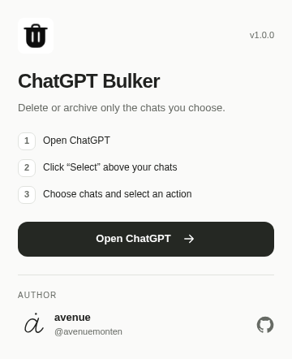

# ChatGPT Bulker

Select, bulk delete, and archive ChatGPT conversations. A small Chrome extension by [avenue](https://github.com/avenuemonten).

**[Download v1.0.0](https://github.com/avenuemonten/chatgpt-bulker/releases/latest)** · [Русская инструкция](docs/README.ru.md) · [MIT license](LICENSE)



## What it does

- Select individual conversations or an entire group.
- Delete or archive the selected chats with confirmation.
- Stop a running operation and resume the remaining queue.
- Open ChatGPT from the toolbar popup.

ChatGPT's interface language is used for the selection controls. The extension popup is in English.

## Download and install

1. Open [Releases](https://github.com/avenuemonten/chatgpt-bulker/releases/latest) and download **`chatgpt-bulker-1.0.0.zip`** from **Assets**.
2. Extract the ZIP to a folder you will keep on your computer.
3. Open **`chrome://extensions/`** in Chrome.
4. Enable **Developer mode**, then click **Load unpacked**.
5. Choose the extracted folder containing **`manifest.json`**.
6. Open [ChatGPT](https://chatgpt.com/) and refresh the tab.

Keep one copy of the extension enabled. Pin it from Chrome's extensions menu to access the toolbar popup.

## Choose the chats you want

1. Click **Select** above the conversation list in ChatGPT.
2. Tick the conversations you want to manage. You do not need to select all chats.
3. Click **Delete** or **Archive** and confirm.

Deletion cannot be undone. Archived chats remain in your ChatGPT account.

## Privacy

Selected actions are sent directly to ChatGPT using your current session. The queue and preferences stay in Chrome. There is no developer server or telemetry. The author's GitHub profile opens only when you click its link.

## Development

No dependency installation or build step is needed to load the source folder as an extension.

```sh
npm run check
npm run package:chrome
```

The ZIP is written to `dist/`, with `manifest.json` at its root. It excludes Git history, development scripts, browser profiles, and previous archives.

The source is also distributed as **`@avenuemonten/chatgpt-bulker`** on GitHub Packages. For a regular Chrome installation, use the ZIP from Releases. Publishing is handled by the repository's release workflow.

## Contributing

Fork the repository and open a pull request. For a bug report, include your Chrome version and steps to reproduce it. Do not include session tokens or private conversations.

## License

[MIT](LICENSE) · Copyright © 2026 avenue. Bundled third-party notices are preserved; see [NOTICE](NOTICE).
